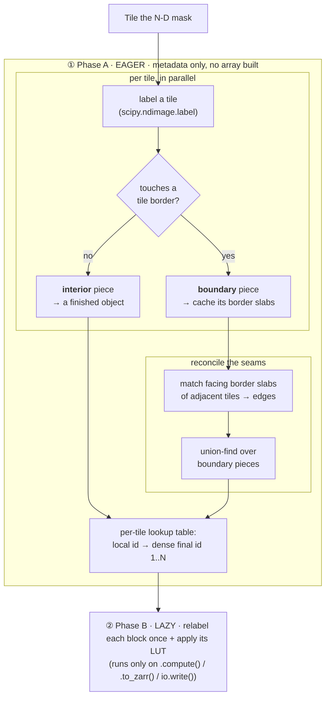

# tilewise-ccl

Fast tile-wise **connected-components labeling** for large N-dimensional arrays,
returning a lazy array of labels.

`tilewise_ccl.label_array` takes any large N-D binary mask (NumPy, Zarr, or Dask backed) and returns a **lazy array** of connected-component labels (a dask array by default), computed with a tile-local labeling pass plus a small global boundary-piece graph. It is:

- **Fast**: only components that touch a tile border are reconciled, through a small global graph, so the reconciliation cost stays small as the number of tiles grows.
- **Memory-bounded**: peak working memory is primarily controlled by tile size and concurrency rather than the total array size, so it labels arrays far larger than RAM. (On the dask backend the output chunking matters too. See [Choosing tile_shape](#choosing-tile_shape).)
- **Composable**: the result is a lazy array (dask array by default), so it plugs straight into other lazy operations, such as  slicing, arithmetic, masking, region-property computation, etc.
- **N-dimensional**: 2D, 3D, or higher; connectivity is configurable.
- **Storage- and domain-agnostic**: no image-format dependency; just NumPy + SciPy + Dask (`dyna-zarr` is optional for performance benefits).
- **Dask-optional**: the `dyna` backend (see [Backends](#backends)) runs the whole thing through [dyna-zarr](https://github.com/bugraoezdemir/dyna_zarr)'s pull model instead of Dask (no task graph).

Labels are **dense integers `1..N`** (background `0`), `int32` when `N < 2**31` else `int64`.

---

## Installation

```bash
pip install tilewise-ccl
# or, from a checkout:
pip install -e .
```

Requires Python ≥ 3.11 and `numpy`, `scipy`, `dask`.

Optional extras, each needed only by the feature that names it:

```bash
pip install "tilewise-ccl[dyna]"   # backend="dyna": no task graph; pull-model tile reads(faster) 
pip install "tilewise-ccl[cc3d]"   # labeler="cc3d": a faster per-tile CCL kernel (3-D)
pip install "tilewise-ccl[all]"    # both
```

---

## Quick start

`label_array` expects a **binary mask** (anything truthy is foreground). The input can be a lazy array (such as a dask array), and it is read tile by tile, so nothing needs to fit in memory at once.

`label_array` runs an eager metadata pass over the whole input array. Each tile is labeled independently. Components that touch tile boundaries are then reconciled through a small union-find graph. **Importantly,** the labeling step is eager but applied tile by tile and in a memory-bounded fashion. 

The resulting connected components are equivalent to those obtained by running `scipy.ndimage.label` on the whole array and are independent of `tile_shape`.

That eager pass is called **Phase A** below, and the lazy half that follows it is
**Phase B**: applying the per-tile lookup tables to produce the final labels and write them
out. Both phases are memory-bounded, which scale primarily with the `tile_shape` and the number of threads (or processes) given. Phase A is paid once, when you call `label_array`. Phase B runs only when you compute or write a region, and only for that region. Both names are used throughout this README.

```python
import dask.array as da
from tilewise_ccl import label_array

# read one array directly from a zarr store (for instance, an OME-Zarr level)
arr = da.from_zarr("dataset.zarr/0")     # e.g. a huge 3D volume, uint8/uint16
mask = arr > 128                          # lazy boolean mask

# On the dask backend it is recommended to keep tile_shape equal to the input dask array's chunk shape
# (the default behaviour). This setting keeps the memory cost low. Using larger tiles
# gains speed but leads to significant memory costs in the writing step, due to the
# rechunking overhead in the task graph.
labels = label_array(mask, connectivity=2, max_threads=4)

# The output is also a dask array. You can stream it straight to disk, process it
# further, or materialize a part of it.
labels.to_zarr("labels.zarr", overwrite=True)
crop = labels[:64, :64, :64].compute()    # a NumPy array of labels 1..N

# opt in to diagnostics (object/graph counts, timings) -> returns a tuple
labels, diag = label_array(mask, connectivity=2, max_threads=4, diagnostics=True)
print(diag["n_final_objects"])
```

A NumPy array works too, and so does a `zarr.Array`: anything the backend can read tile by
tile. See [Backends](#backends) for what each accepts.

### The same, with the `dyna` backend

The identical job through [dyna-zarr](https://github.com/bugraoezdemir/dyna_zarr)'s
pull model (uses no task graph). Install the `[dyna]` extra. At the same `tile_shape` the labels are byte-identical to the dask path. Only the execution differs. See
[Backends](#backends) for what changes and why.

```python
from dyna_zarr.io import io as dio
from tilewise_ccl import label_array

# read one array directly from a zarr store, as above
arr = dio.read("dataset.zarr/0")          # a DynamicArray, not a dask array
mask = arr > 128                          # lazy, and FUSED into each tile read

# The backend is inferred from the mask type: a DynamicArray selects the dyna path.
# dyna writes the chunks requested directly, so a tile larger than the storage
# chunk costs nothing extra on the write. The memory cost scales with the tile
# instead (roughly tile_shape * max_threads), which makes it the knob to tune here.
labels = label_array(mask, tile_shape=(384, 384, 384), connectivity=2, max_threads=4)

# The result is a lazy DynamicArray. Write it with dyna-zarr's writer, which picks
# up the tile grid automatically (see the note below).
dio.write(labels, "labels.zarr", chunks=(96, 96, 96),
          max_workers=8, overwrite=True)

# ...or materialize just a part of it, without computing the rest
crop = labels[:64, :64, :64].compute()    # a NumPy array of labels 1..N
```

Three things differ in the dyna backend compared to the dask backend above:

- **The threshold costs nothing extra.** `arr > 128` is never materialized. Each tile applies the comparison as it is pulled, so there is no separate mask array and no per-tile scheduler overhead.
- **The tile and the output chunk are independent and no rechunking applied.** dyna writes the chunks requested directly, with no block-splitting step, so, for instance, `chunks=(96, 96, 96)` under a 384³ tile costs nothing extra. That is why the tile here is larger than on the dask path: it is free on the write, and it makes Phase A faster. Memory then scales with the tile (roughly `tile_shape × max_threads`), which is the knob to tune.
- **The tiling does not need to be restated on the write.** `label_array` records its `tile_shape` on the returned array and `dio.write` picks it up, so write regions land on tile borders and each tile is read and labeled exactly once. This survives slicing: `labels[13:525]` carries the same grid, shifted by the slice start, so writing a crop does not fall back to recomputing tiles once per region.

### Downstream composability

The labeling is lazy, and the output composes with furter lazy processing. With
`properties=True`, every object's size and bounding box can be obtained as **metadata**, without a second pass over the data. This enables the identification of objects of interest at the labeling time and then reading of any desired objects using their bounding boxes.

```python
import numpy as np

labels, diag = label_array(mask, connectivity=2, max_threads=4, properties=True)

# area / bbox come from the per-tile pass. No extra read of the array is necessary.
i    = int(np.argmax(diag["area"]))          # the largest object
lbl  = int(diag["label_values"][i])
lo, hi = diag["bbox_start"][i], diag["bbox_stop"][i]

# read back ONLY that object's bounding box (.compute() works on both backends)
crop = labels[tuple(slice(int(a), int(b)) for a, b in zip(lo, hi))].compute()
obj  = crop == lbl                            # the object itself, isolated
```

Only the box is materialized during Phase B; the rest of the labeled output is never computed.


---

## API

### `label_array(mask, tile_shape=None, connectivity=2, max_threads=None, diagnostics=False, properties=False, verbose=False, backend="auto", labeler="scipy", max_processes=None)`

Label connected components of a binary N-D mask into a lazy array (a dask array by
default, a `dyna_zarr` `DynamicArray` on `backend="dyna"`).

**Returns:**

- **By default** (`diagnostics=False`): just `output_labels`, a lazy array of
  dense labels `1..N` (background `0`), same shape as `mask`. dtype is `int32`
  when `N < 2**31`, else `int64`. It is a `dask.array.Array` with the default
  `backend="dask"`, and a `dyna_zarr` `DynamicArray` with `backend="dyna"`.
- **With `diagnostics=True`**: a tuple `(output_labels, diag)`, where `diag` is a
  `dict` of object/graph counts and timings (see below).

```python
labels = label_array(mask)                          # -> dask.array.Array
labels, diag = label_array(mask, diagnostics=True)  # -> (dask.array.Array, dict)
```

#### Parameters

| Parameter | Type | Default | Description |
|---|---|---|---|
| `mask` | `np.ndarray` \| `dask.array.Array` \| `zarr.Array` | *required* | N-D array; truthy elements are foreground. Read tile by tile, so it may be far larger than RAM. |
| `tile_shape` | sequence of int | `None` | Size of each processing tile, **one entry per dimension** (its length must equal `mask.ndim`). `None` picks one for you: on `backend="dask"` with a chunked mask it uses the **storage chunk** (the memory-safe choice, since a bigger tile makes dask split every block on the way out); otherwise a ~256 MiB working set over the trailing 3 (spatial) axes, snapped to whole storage chunks, leading (t/c-like) axes left at 1. Pass it explicitly to trade memory for speed. This is an *execution hyperparameter* and does not change the result. See [Choosing `tile_shape`](#choosing-tile_shape). |
| `connectivity` | int | `2` | Passed to `scipy.ndimage.generate_binary_structure(ndim, connectivity)`. Higher = more diagonal neighbors are considered connected (see [Connectivity](#connectivity)). |
| `max_threads` | int | `None` (1) | If `> 1`, the eager metadata pass (Phase A) runs over tiles in a pool of this many threads. Each tile touches only its own region, so this is safe. Phase B is lazy: its threads are set by whatever computes or writes the result (dask's scheduler, or `dyna_zarr.io.write(max_threads=)`). |
| `diagnostics` | bool | `False` | If `True`, also return a `diag` dict (the function returns a `(labels, diag)` tuple instead of just `labels`). |
| `properties` | bool | `False` | Also compute per-object `area` (voxel count) and `bbox_start`/`bbox_stop` (half-open global bounding box) into `diag`, which implies returning the tuple. Aggregated from per-tile partials, so memory stays bounded by tile size no matter how large an object is. |
| `backend` | `"auto"` \| `"dask"` \| `"dyna"` | `"auto"` | Execution backend. `"auto"` infers it from the mask type: a `DynamicArray` gets the dyna path, anything else gets dask, so you rarely pass this. See [Backends](#backends). |
| `max_processes` | int | `None` | Phase A in a pool of this many processes instead of threads (give one of the two). Threads are the right default at moderate input chunk sizes; processes only pay off when the input is finely chunked and the per-tile read is GIL-bound. See [Backends](#backends). |
| `labeler` | `"scipy"` \| `"cc3d"` | `"scipy"` | Per-tile CCL kernel. `"cc3d"` (needs the `[cc3d]` extra, 3-D only) is ~2x faster per call but **holds the GIL**, so it only pays off with `max_processes`. Both emit identical labels. |
| `verbose` | bool | `False` | Print per-tile progress for Phase A (immediately) and Phase B (when the returned array is computed/written). |

`max_threads` and `max_processes` replace `n_workers` and `executor` of 0.0.6 and earlier (`n_workers=N, executor="process"` is now `max_processes=N`). The old names still work, with a `FutureWarning`.

> **Note.** `tile_shape` must have the same length as `mask.ndim`; a mismatch
> raises `ValueError`.

#### `diag` fields (returned only when `diagnostics=True`)

| Key | Meaning |
|---|---|
| `n_tiles`, `grid_shape` | Number of tiles and the tile-grid shape. |
| `n_final_objects` | Total number of connected components (== `N`). |
| `n_interior_objects` | Objects fully contained in a single tile (resolved locally, never entered the graph). |
| `n_boundary_pieces`, `n_edges`, `n_boundary_groups` | Size of the boundary-reconciliation graph: pieces touching a tile border, edges between them, and the resulting merged groups. |
| `n_objects_single_tile` | Objects occupying exactly one tile (do **not** cross a tile border). |
| `n_objects_crossing` | Objects that cross into ≥2 tiles. |
| `n_objects_crossing_gt3_tiles` | Objects spanning >3 tiles (large objects). |
| `max_tiles_spanned` | Maximum number of tiles any single object spans. |
| `output_dtype` | dtype of `output_labels` (`"int32"` or `"int64"`). |
| `time_phaseA_s`, `time_reconcile_s`, `time_total_s` | Eager-phase timings (seconds). Phase B's cost is incurred later, on compute/write. |

---

## Connectivity

`connectivity` selects the neighborhood via
`scipy.ndimage.generate_binary_structure(ndim, connectivity)`. An offset counts
as a neighbor iff its number of nonzero components is `≤ connectivity`:

| ndim | `connectivity=1` | `connectivity=2` | `connectivity=3` |
|---|---|---|---|
| 2D | 4-connected (faces) | 8-connected (+ corners) | n/a |
| 3D | 6-connected (faces) | 18-connected (+ edges) | 26-connected (+ corners) |

Cross-tile connections (including diagonal corner/edge crossings between tiles)
are handled correctly for every connectivity, so the label result is identical to
a single whole-array `scipy.ndimage.label`, independent of `tile_shape`.

---

## Choosing `tile_shape`

`tile_shape` is a performance/parallelism knob: it does **not** change which voxels
belong to which object. Only the label numbers follow the tile order, so two tile
sizes give the same objects numbered differently. Guidance:

- **Bigger tiles** → more objects fit entirely inside one tile → fewer boundary
  pieces → smaller reconciliation graph and less per-tile overhead. The cost is
  more memory per tile (one `scipy.ndimage.label` call per tile) and
  coarser parallelism.
- **The default is usually fine.** With `tile_shape=None` on `backend="dask"` and a
  chunked mask, the tile IS the storage chunk, which is the memory-safe choice. Otherwise
  (dyna, or a mask with no chunking) `label_array` targets a ~256 MiB int32 working
  set over the trailing three axes and snaps it to whole storage chunks, so the tile
  is always a chunk multiple and no chunk is read twice. On a 3-D array chunked at
  `96³` that lands on `384³`; on a 5-D `(t, c, z, y, x)` it tiles `z/y/x` only and
  leaves `t`/`c` at 1.
- Override it when you have memory to spare. Phase A holds a few tiles at once, so
  its cost scales with `max_threads × (tile voxels)`: at 128³ tiles and 4 workers that
  measured ~350 MiB, and at 256³ tiles ~1 GiB. Bigger tiles mean fewer boundary
  pieces and a smaller reconciliation graph, at that cost.
- It is **decoupled from storage chunking**: `label_array` reads whatever tile
  size you ask for directly, regardless of how the data is chunked on disk, so
  there is no need to `rechunk` the input first. This keeps it efficient even on
  natively small-chunked data.
- **On the dask backend the default tile IS the storage chunk**, because Phase B
  emits one block per tile: a tile larger than the output chunk makes dask split
  every block on the way out, and that split (not the labeling) dominates peak
  memory. Raising `tile_shape` buys speed with memory (1 GiB volume, 64³ chunks,
  4 workers: 44.8 s / 2340 MiB at 384³ tiles against 66.4 s / 642 MiB at 64³), so
  raise it when you know the headroom is there. Writing to a chunk SMALLER than the
  tile is the case to avoid (128³ tiles, 4 workers):

  | input | `chunks == tile` | `chunks = tile/2` |
  |---|---|---|
  | 1 GiB | 563 MiB | 965 MiB |
  | 8 GiB | 728 MiB | 1780 MiB |
  | 15.6 GiB | 1066 MiB | 2662 MiB |

  Labeling with large tiles and then writing to small chunks is the combination to
  avoid. If you need small storage chunks, use the `dyna` backend, which writes
  them directly.

Phase A's memory is `max_threads × (tile voxels) × (a few bytes)`, or ~300 to 400 MiB on
every volume above. The write is what varies; see the table.

---

## How it works: interior-boundary reconciliation

`tilewise-ccl` is a **tile-wise** connected-components labeler: label each tile on its
own, then merge the components that meet across tile borders. It adapts that
classic idea with two moves that keep it fast and memory-bounded:

**1. Interior-boundary separation** shrinks what must be reconciled. A
component touching none of its tile's borders is already a finished object and is
set aside at once. Only components touching a border (the ones that might continue
into a neighbour) are reconciled. So the global step is a small graph over
**border pieces**, whose size tracks the tiles' seam area, not the object count,
and stays flat as the number of tiles grows.

**2. Plan first, materialize once** separates reading from writing. The first
pass touches every voxel but keeps only compact **metadata** (which pieces merge, plus
a per-tile lookup table) and allocates **no output array**. The labels are lazy and
materialize exactly once, on `.compute()` / `.to_zarr(...)` / `io.write(...)`,
relabelling each block in a single pass. Peak memory scales with tile size ×
concurrency (a handful of tiles), never the whole array, and **no voxel is written
twice**.

In short: most objects sit inside a single tile and are finished there (cheap);
only the few that straddle a **seam** between tiles ever need the reconciliation
graph.

### The two phases



**Phase A** (eager, metadata only) runs in two steps, both finished by the time `label_array` returns.

*Label each tile*: one at a time and in parallel: read a tile and label it with `scipy.ndimage.label`, then split its components into **interior** (touch no border → finished) and **boundary** (touch a border → deferred, their border slabs cached). Only small per-tile metadata is kept (not the voxel data), so memory is bounded by `tile size × max_threads` and the pass runs safely across a thread pool. **No output array is allocated.**

*Reconcile the boundary pieces*: compare the facing border slabs of adjacent tiles (faces, plus edge/corner diagonals for higher connectivity); where foreground meets foreground, link the two boundary pieces. A union-find over those pieces merges them into whole objects, and each tile gets a lookup table from its local ids to dense final ids `1..N`. This little plan is the *entire* global result.

**Phase B** (lazy; materialize once) relabels each block and applies that tile's lookup table, emitting final labels directly, **with no read-modify-write of an output buffer**. Nothing runs until you `.compute()`, `.to_zarr(...)` or `io.write(...)`, and each chunk is produced exactly once.

Because most objects are interior, the reconciliation graph is pure metadata over border pieces, and the array is only ever built lazily, cost stays low even for pathological inputs: an object spanning hundreds of tiles still reconciles in well under a second.

---

## Backends

`backend` selects how tiles are READ and how Phase B is expressed. At the same
`tile_shape` both produce byte-identical labels, so it is purely an execution choice.

### `backend="auto"` (default)

Picks `"dyna"` when `mask` is a `dyna_zarr` `DynamicArray`, `"dask"` otherwise. The
mask type already determines which path is viable, since the dyna path accepts nothing
else, so the backend is normally not worth stating. Pass it explicitly only to
force the dask path for a `DynamicArray` mask (which works: each tile is
materialized as it is pulled).

### `backend="dask"`

`mask` may be a NumPy, Zarr, or Dask array. Phase B is a `da.map_blocks` over the
mask, so the result is a genuine `dask.array.Array` that composes with the rest of
dask (see [Downstream composability](#downstream-composability)).

### `backend="dyna"`

Selected automatically when `mask` is a [dyna-zarr](https://github.com/bugraoezdemir/dyna_zarr)
`DynamicArray` (install the `[dyna]` extra). Phase A pulls each tile directly
through dyna's pull model, and Phase B is a native dyna `map_overlap`: each read pulls
only what it needs through a chain of lazy operations, with **no task graph built at all**
(neither dask's nor one of its own). Two things make this fast:

- A lazy threshold is **fused into the tile read**. `io.read(path) > 128` is not
  materialized; each tile applies the comparison as it is pulled, so there is no
  separate mask array on disk and no scheduler overhead per tile.
- Reads are memory-bounded by construction: a tile pull reads exactly the region
  asked for.

The returned array is a lazy `DynamicArray`, so write it with dyna-zarr's writer
rather than `.to_zarr()`. See the [worked example above](#the-same-without-dask-the-dyna-backend).

- **It writes the chunks requested, directly, without the need for a rechunking.** Therefore, there is no block-splitting step, so fine output chunks cost nothing extra in memory, which is the case where the dask path is most expensive.

### Picking a backend

Measured on a 1024³ uint8 volume (1 GiB) of mixed-scale objects: 17,086 components from
~20-voxel specks up to a 386×589×311 structure crossing four tiles. It is stored in 64³ chunks, and after labelling, it is written back to 64³ chunks, 4 workers. Each backend runs at the tile size that suits
it: dask writes at its tile shape (no block splitting), dyna writes the requested chunks
directly. **Both find the same 17,086 objects** (numbered differently, since the tile sizes differ):

| backend | tile | Phase A | Phase B (write) | total | peak RSS |
|---|---|---|---|---|---|
| `dask` | 64³ | 21.9 s | 16.1 s | 38.0 s | 651 MiB |
| `dyna` | 128³ | **2.4 s** | **9.8 s** | **12.2 s** | **345 MiB** |

`dyna` is ~3x faster end to end on about half the memory, and the margin is widest in
Phase A (~9x here): dask assembles each tile from many small chunk reads through its task
graph, while dyna pulls the region directly. **The finer the input chunking, the bigger the gap**. With coarse 128³ input chunks it narrows to ~1.2x, and with small 32³ chunks it grows to ~3.5x.

Peak memory follows the tile: dyna at 256³ tiles peaks near 1 GiB, at 128³ near 350 MiB.
Set `tile_shape` to the memory you can afford.

### What a crop actually costs

Phase A runs once over the whole volume; after that the labels are lazy, so the write cost
tracks the requested region. Same volume as above, writing each target on its own:

| target | % of volume | `dask` write (tile 64³) | `dyna` write (tile 128³) |
|---|---|---|---|
| full volume | 100% | 16.20 s | 9.71 s |
| one half | 50% | 8.16 s | 5.15 s |
| one octant | 12.5% | 2.13 s | 1.41 s |
| largest object's bbox | 0.035% | 0.08 s | 0.39 s |
| a median-sized object | 0.000006% | 0.02 s | 0.10 s |

Peak RSS stays flat down each column (~630 to 650 MiB for dask, ~360 to 400 MiB for dyna)
because it is set by `tile_shape × max_threads`, not by how much you write.

Note the crossover at the bottom: dask's 64³ tiles make sub-tile crops cheaper than dyna's
128³ ones, since a crop smaller than a tile still labels whole tiles. That is a `tile_shape`
effect, not a backend one: drop dyna to 64³ tiles and it matches. The trade is worth it in
the other direction: the larger tile is what makes dyna's Phase A ~9x faster.

This benchmark was obtained on one machine. The qualitative behaviour should generalize, but the absolute timings and ratios depend on hardware, chunking, tile size and workload.

`labeler="cc3d"` follows the same logic: it is faster per call but holds the GIL, so it works best with `max_processes`.


---
